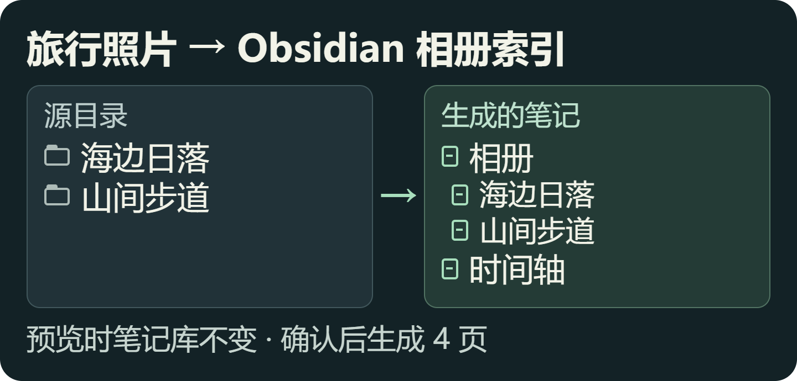

# changyi

我做 Windows 小工具和 Agent Skills，主要用来整理本地资料、处理视频。

## 给硬盘里的资料做个目录

[**Obsidian Bookshelf**](https://github.com/zcy205321334-bit/obsidian-bookshelf) 会把硬盘上的目录变成 Obsidian 里的总览和条目卡片。整理前先看预览，确认后才写入笔记库。我用两组虚构的旅行照片试跑，生成了相册索引、时间轴和两张条目卡片。

[安装 Skill](https://github.com/zcy205321334-bit/obsidian-bookshelf#-安装) · [看预览与写入的命令示例](https://github.com/zcy205321334-bit/obsidian-bookshelf/blob/main/references/examples.md#preview-与-apply)

## 我做的其他工具

- **[Video2Mp4](https://github.com/zcy205321334-bit/Video2Mp4)** 把 MOV、MKV 等视频批量转成 MP4。音视频兼容时可以直接换容器。[下载 Windows 版](https://github.com/zcy205321334-bit/Video2Mp4/releases/latest)，需要先[配置 FFmpeg](https://github.com/zcy205321334-bit/Video2Mp4#-安装)。
- **[VideoSlim Enhanced](https://github.com/zcy205321334-bit/VideoSlim)** 用来压缩视频。基于 [VideoSlim 原版](https://github.com/DongGuoZheng/VideoSlim)，增加了编码器选择、码率控制和音频选项。
- **[AI 学习播客](https://github.com/zcy205321334-bit/daily-ai-learning-podcast)** 把 GitHub 项目整理成讲稿和音频。
- **[记账小助手](https://github.com/zcy205321334-bit/bookkeeping_assistant)** 手动录入或用图片辅助识别账单，关闭页面前要导出备份。
